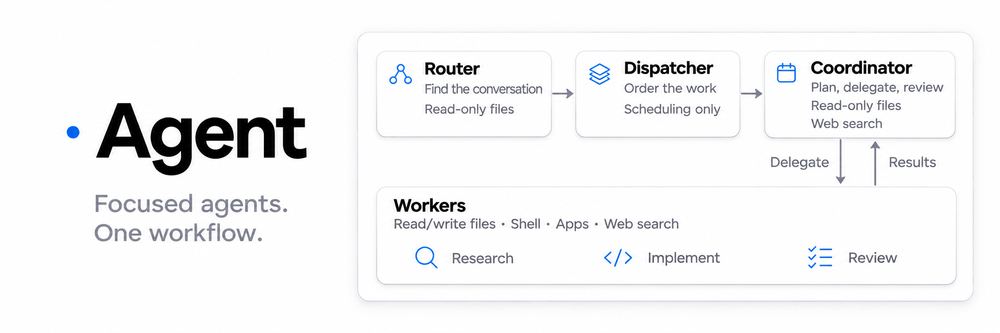

# Agent



A local assistant that runs independent tasks in parallel, waits for dependencies, and preserves conversations and progress across restarts.

**Start** (Node 26+):

```bash
cd agent
npm ci --ignore-scripts
npm start
```

Install and sign in to at least one CLI on the Agent host with `codex login`, `claude auth login`, or `agy acp --login`. Open `http://127.0.0.1:4180` and click the status dot to check connections and choose a model.

For native app control, install Codex Computer Use in the desktop app. On macOS, `service/install.sh` starts Agent after login; `service/uninstall.sh` removes the service.

[Usage](docs/usage.md) · [Headless setup](docs/headless.md) · [Development](docs/development.md)
