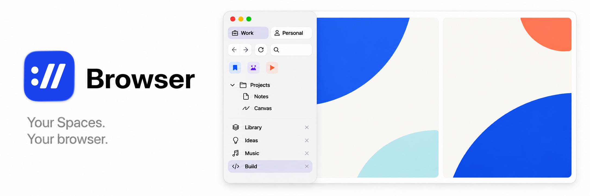

# Browser



A native macOS browser with separate Spaces for work and personal browsing.
Built with SwiftUI, AppKit, and WebKit.

[itsbrowser.com](https://itsbrowser.com)

- **Spaces** keep website sessions separate. Private Spaces stay in memory.
- **Sidebar** keeps pins, saved tabs, folders, GitHub live folders, and media controls together.
- **Browsing** includes split views, translation, Reader Mode, downloads, history with recently closed tabs, and browser import/export.
- **Content blocking** downloads uBlock Origin Lite on first launch, with Complete mode and settings for each Space.

**Build and run** (Apple silicon, macOS 26.1+, Xcode, and [XcodeGen](https://github.com/yonaskolb/XcodeGen)):

```sh
cd browser
brew install xcodegen
xcodegen generate
xcodebuild -project Browser.xcodeproj -scheme Browser -configuration Release build
```

Open `Browser.xcodeproj` in Xcode to run the app. Local builds use ad hoc signing.
Passkeys require an Apple-authorized browser signing profile with
`CODE_SIGN_ENTITLEMENTS=Config/Browser.entitlements`.

## Everyday use

Move to the left edge to reveal the sidebar; drag its right edge to resize it.
Use **⌘L** for addresses and commands, **⌘T** for a new tab, **⌃Tab** for recent tabs,
and **⌥⌘←/→** to switch Spaces. Swipe over a page to go back or forward,
or over the sidebar to switch Spaces.

Settings controls page zoom, content blocking, and data retention.
Sessions are saved in `~/Library/Application Support/Browser/SwiftSession`, with a previous
checkpoint for recovery. For isolated review builds, set `BROWSER_REVIEW_DATA_DIRECTORY`
to a disposable directory and use a distinct bundle identifier.

Browser checks for blocker updates when it opens and applies downloaded updates on the next launch.
To publish a blocker update, run `python3 scripts/update-ublock-origin-lite.py [VERSION]`
from this directory and commit the two updated feed files. Omitting the version selects the latest upstream release.

Source is [MPL-2.0](LICENSE), derived from [Crest](https://github.com/pauljoda/Crest).
See [third-party notices](THIRD_PARTY_NOTICES.md) and [trademark terms](TRADEMARKS.md).
