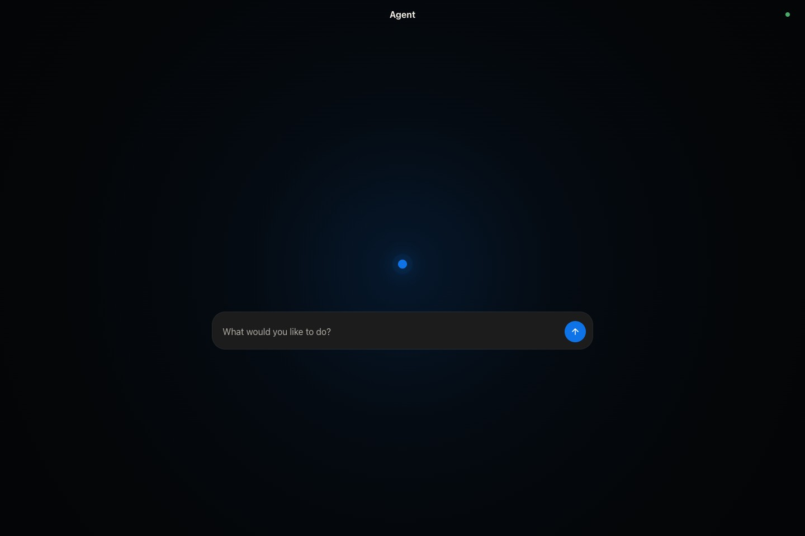

# Agent



A local agent built on Pi Durable. Home routing chooses conversations in message order and hands off immediately to a separate dispatch queue for each conversation. Dispatch decisions stay ordered within a conversation and run concurrently across conversations; messages sent inside a conversation bypass routing. The dispatcher starts independent requests concurrently and records prerequisites for dependent follow-ups. Each request runs a coordinator against its own history snapshot, delegates execution to workers, and publishes its completed answer atomically to the shared conversation. Waiting for workers never blocks independent requests. Workers have coding, shell, computer-use, and delegation tools, with separate conversations and private working notes. Up to eight execution model requests run concurrently, with additional capacity reserved for dispatch and Home routing. Task dependencies, completion receipts, conversations, and queues survive service restarts. The UI keeps tools and reasoning private and identifies which request each answer belongs to. Interrupted unsafe tools are reported instead of replayed.

Open `http://127.0.0.1:4180`. Reply quotes a selected message; thumbs-up sends “Yes, go ahead.” Dependent messages show what they are waiting for and support Edit, Delete, and Steer. Corrections replace their target task and redirect waiting dependents; cancellation stops the selected task. Stop preserves waiting work; Continue resumes the stopped request before follow-ups. The composer stays mounted during replies, navigation, and reconnects, with drafts saved per conversation. Tab accepts a saved, tool-free reply suggestion; Escape dismisses it or clears its quote.

Conversations and workers use native web search with OpenAI, Anthropic, xAI, and the listed Gemini models. Public lookups use provider-hosted search first; browser interaction is a fallback for inaccessible content, authenticated sites, or tasks that require interaction. The router, dispatcher, and reply suggestions do not receive search tools.

When there are no saved conversations, the first Home message starts a session immediately, skipping the routing model. Later messages use Home routing, which has Pi's read-only filesystem tools to locate project folders. Ask to switch folders within a conversation; `working_directory` validates and saves the change and loads that folder's instructions and skills. Existing workers keep their directories; new workers inherit the updated one.

## Start

Requires Node 26+. Click the dot, choose Sign in, API key, or Cloud, then search for a provider to connect. Sign-in opens in a browser tab; the link remains available if pop-ups are blocked. Browser logins finish through Pi's callback listener. Code entry appears when required by the provider's login method. Click a connected provider to select a model or disconnect. The selection applies to new tasks; existing conversations keep their model. Router and dispatcher use GPT-6 Luna or Claude Haiku 5.5 with reasoning disabled, Gemini 3.5 Flash-Lite at minimal, or Grok 4.7 at low. Gemini and Grok cannot disable reasoning. Other providers use the selected model at low. This mapping applies with fast mode on or off.

```bash
cd tools/agent
npm ci --ignore-scripts
npm start
```

Install Codex Computer Use in the desktop app for native app control. Agent automatically accepts its approval requests. `service/install.sh` starts Agent after login on macOS; `service/uninstall.sh` removes the service.

Connected OpenAI, Anthropic, xAI, and Google accounts show a lightning button to toggle fast mode, including existing conversations and reply suggestions on their next request. Fast mode starts off and costs more; model compatibility is handled automatically. Gemini priority requires an eligible paid account; older Claude Opus previews require fast-mode access. Model pickers use a curated current lineup because Pi's catalog has no release dates: GPT-6.1 Sol, GPT-6 Astra, and GPT-6 Luna; Claude Fable 5.1 and Opus/Sonnet/Haiku 5.5; Gemini 4 Argon, 3.8 Flash, and 3.5 Flash-Lite; and Grok 4.7.

State and transcripts live in `~/.agent/durable.sqlite`; suggestions live in `~/.agent/suggestions.db`. Provider credentials stay in `~/.agent/auth.json`, with the selected provider and model in `~/.agent/provider.json` and per-provider fast preferences in `~/.agent/fast-mode.json`. Pi manages the installation ID in `~/.agent/settings.json`.

This is a single-user app. For incompatible persistence changes, stop the server, delete `durable.sqlite` and `suggestions.db` from `~/.agent/` together with any `-wal`, `-shm`, or `-journal` sidecars, then restart. This clears conversations, tasks, and suggestions while preserving provider credentials and preferences.

Run `npm run check`, `npm run test:tasks`, `npm run test:delegation`, `npm run test:providers`, and `npm run test:composer` (requires Google Chrome). The [instruction benchmark](evals/benchmark/README.md) uses Durable for native agent integration. `npm run eval:suggestions` runs the tool-free suggestion trials with the saved Codex login.

## Headless

On a headless Linux host with Node 26+, install dependencies as above and log in from the terminal before starting Agent:

```bash
npm run login -- openai
npm start
```

`npm run login` lists provider IDs and methods. Login prefers OAuth when available; append `api_key` for key setup, for example `npm run login -- openai api_key`. The CLI uses Pi's authentication and the same credentials, installation ID, and selected provider as the UI. Restart Agent if it was already running when CLI login finished.

Open the CLI's sign-in link in your laptop's browser. Pi's device-code, copy-code, and manual redirect prompts remain available in the terminal where supported. OpenAI browser login needs port 1455 forwarded over SSH, or the final redirect URL pasted into the CLI.

To use the UI from your laptop, forward the web UI and OpenAI's callback port:

```bash
ssh -N -L 4181:127.0.0.1:4180 -L 1455:127.0.0.1:1455 user@pi-host
```

Open `http://127.0.0.1:4181` on your laptop and sign in there. Port 1455 must be free on your laptop; forwarding it lets OpenAI return to Agent on the host automatically. API keys need no browser callback.

The service installer is macOS-only. Codex Computer Use requires the desktop plugin; it is unavailable on a headless Raspberry Pi. Coding and shell tools run on the host.
