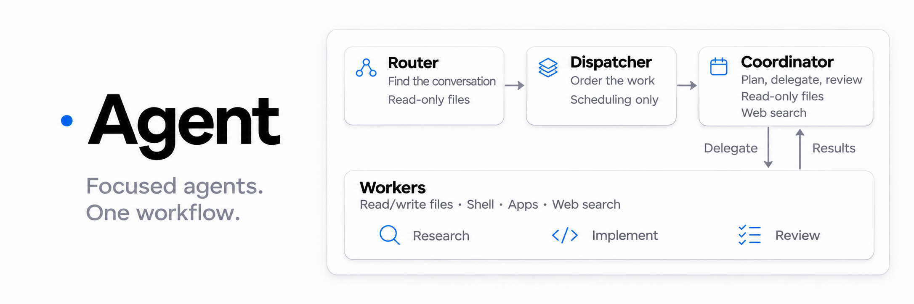

# Agent



A local assistant with focused agents, each with a distinct role and tool access.

| Agent | Responsibility | Main tools |
| --- | --- | --- |
| Router | Find the right conversation | Read-only files, conversation lookup |
| Dispatcher | Order tasks and dependencies | Task decisions only |
| Coordinator | Plan, delegate, and check results | Read-only files, web search, delegation |
| Workers | Execute focused tasks | File read/write, shell, web search, computer use, delegation |

The coordinator delegates file changes, shell commands, and app interaction to workers.

Independent tasks run in parallel. Follow-ups wait for the results they need. Conversations and task progress survive restarts.

**Start** (Node 26+):

```bash
cd tools/agent
npm ci --ignore-scripts
npm start
```

Open `http://127.0.0.1:4180`, click the status dot, and connect a provider using Sign in, API key, or Cloud.

For native app control, install Codex Computer Use in the desktop app. On macOS, `service/install.sh` starts Agent after login; `service/uninstall.sh` removes the service.

[Usage](docs/usage.md) · [Headless setup](docs/headless.md) · [Development](docs/development.md)
