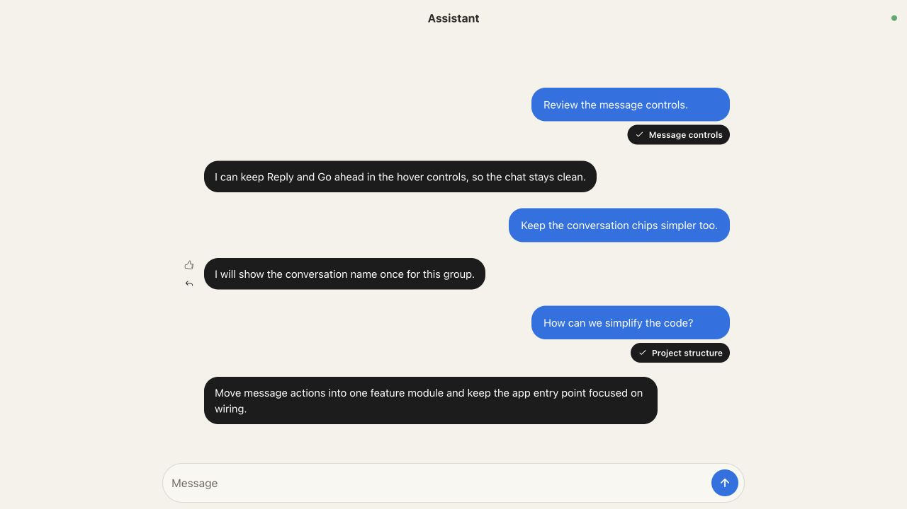

# Assistant



A local assistant built on Pi Durable. Home routes requests to persistent conversations, showing the assigned name once known and omitting repeated names on consecutive messages. Each session agent uses read-only filesystem tools to plan, delegates execution to workers, and assesses the evidence returned. Workers have coding, shell, computer-use, and delegation tools and inherit the parent's model and working directory, with separate conversations and private working notes. `working_notes` reads or replaces a compact, durable note of up to 6,000 characters; current notes appear in the agent's context. Outstanding work is collected before finishing or explicitly cancelled, including nested delegations. Up to eight model requests run concurrently across sessions and workers, with one additional slot reserved for Home routing. Conversations, notes, queues, and streamed progress survive service restarts. The browser shows assistant progress and replies, keeping tool calls and reasoning out of the UI; Pi commits streamed updates every 16 ms. Interrupted unsafe tools are reported instead of replayed.

Open `http://127.0.0.1:4180`. On an empty Home, tap the spark or a starting point to prefill an editable prompt. Reply quotes a selected message; thumbs-up sends “Yes, go ahead.” Queued messages support Edit, Delete, and Steer. Stop preserves waiting work; Continue resumes the stopped request before follow-ups. The composer stays mounted during replies, navigation, and reconnects, with drafts saved per conversation. Tab accepts a saved, tool-free reply suggestion; Escape dismisses it or clears its quote.

Home uses Pi's read-only filesystem tools to locate project folders. Ask to switch folders within a conversation; `working_directory` validates and saves the change and loads that folder's instructions and skills. Existing workers keep their directories; new workers inherit the updated one.

## Start

Requires Node 26+. Click the dot, choose Sign in, API key, or Cloud, then search for a provider to connect. Sign-in opens in a browser tab; the link remains available if pop-ups are blocked. Browser logins finish through Pi's callback listener. Code entry appears when required by the provider's login method. Click a connected provider to select a model or disconnect. The selection applies to new tasks; existing conversations keep their model.

```bash
cd tools/assistant
npm ci --ignore-scripts
npm start
```

Install Codex Computer Use in the desktop app for native app control. Assistant automatically accepts its approval requests. `service/install.sh` starts Assistant after login on macOS; `service/uninstall.sh` removes the service.

State and transcripts live in `~/.assistant/durable.sqlite`; suggestions live in `~/.assistant/suggestions.db`. Provider credentials stay in `~/.assistant/auth.json`, with the selected provider and model in `~/.assistant/provider.json`. Pi manages the installation ID in `~/.assistant/settings.json`.

Run `npm run check`, `npm run test:delegation`, and `npm run test:composer` (requires Google Chrome). The [instruction benchmark](evals/benchmark/README.md) uses Durable for native agent integration. `npm run eval:suggestions` runs the tool-free suggestion trials with the saved Codex login.

## Headless

On a headless Linux host with Node 26+, install dependencies as above and log in from the terminal before starting Assistant:

```bash
npm run login -- openai
npm start
```

`npm run login` lists provider IDs and methods. Login prefers OAuth when available; append `api_key` for key setup, for example `npm run login -- openai api_key`. The CLI uses Pi's authentication and the same credentials, installation ID, and selected provider as the UI. Restart Assistant if it was already running when CLI login finished.

Open the CLI's sign-in link in your laptop's browser. Pi's device-code, copy-code, and manual redirect prompts remain available in the terminal where supported. OpenAI browser login needs port 1455 forwarded over SSH, or the final redirect URL pasted into the CLI.

To use the UI from your laptop, forward the web UI and OpenAI's callback port:

```bash
ssh -N -L 4181:127.0.0.1:4180 -L 1455:127.0.0.1:1455 user@pi-host
```

Open `http://127.0.0.1:4181` on your laptop and sign in there. Port 1455 must be free on your laptop; forwarding it lets OpenAI return to Assistant on the host automatically. API keys need no browser callback.

The service installer is macOS-only. Codex Computer Use requires the desktop plugin; it is unavailable on a headless Raspberry Pi. Coding and shell tools run on the host.
