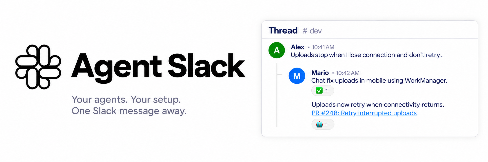

# Slack browser hook

Follow [Browser Hooks setup](../README.md#install-or-update), then send
`chat your request` for Codex or `claude your request` for Claude. Your own
keyword-prefixed messages trigger work in channels and DMs, including messages
sent from your phone. Listening is automatic and invisible while Slack is open.

**👀** stays on the request. Replies appear as you in the same thread; the first
successful agent reply includes a `chat` link when available. Follow-ups resume the
native session and include newer thread context.

Send `chat stop` or `claude stop` in that thread to stop its running and queued
requests and discard replies that have not started sending. Either command stops
all providers in that thread. The saved session and project remain available for
follow-ups; stopping does not undo changes already made. Other request text,
such as `chat stop using polling`, goes to the agent normally.

## Configure

Edit `~/.local/share/browser-hooks/hooks/slack/config.json`, then run
`browser-hooks install`. Each key in `commands` is a trigger keyword. Setup creates
`chat` and/or `claude` for installed CLIs; see [custom adapters](docs/adapters.md)
for other commands.

Set `workspace` for the default directory and `projects` for aliases mapped to
project directories. The first alias in a request selects the project; follow-ups
inherit it. Switching provider or project starts a session with full thread
context. Native models and permissions are preserved; requests have no overall
time limit.

## Recovery and troubleshooting

Accepted work continues if Slack closes or reloads. Reopening the same Slack
workspace/account delivers pending replies. Bridge restarts preserve queued work,
unsent replies and session IDs. Interrupted turns are reported; send a follow-up
in the thread to continue. Uncertain sends are never retried automatically;
messages missed while offline are not replayed.

Run `browser-hooks slack status` for connection details and the last error.
Failures also explain the next step in the Slack thread and popup tooltip. For an
expired login, run `codex login` or `claude auth login`. If another Codex client
owns the chat, finish or release its turn there before retrying from Slack.

Configuration and sessions stay in the private [application folder](../README.md#commands-and-files).
Slack authentication stays in the browser page. Its browser authentication and
event protocol are unofficial and may change.
