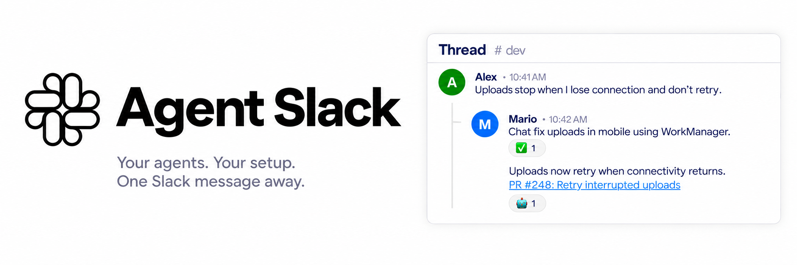

# Agent Slack



A small, self-hosted bridge from Slack to your coding tools. Run it on your laptop or in the cloud, using the repos, commands, and settings you choose.

Configure your own trigger keywords and workspaces. Connect any AI or bot command through a [thin adapter](docs/commands.md); Codex and Claude adapters are included.

A keyword at the start of your own message triggers work. Answers stay in the Slack thread, and follow-ups resume the conversation. Different threads can run in parallel.

**👀** queued or running · **✅** answered · **🤖** AI reply.

**Install or update** (macOS or Linux with systemd, Git, and an authenticated coding CLI):

```sh
curl -fsSL https://raw.githubusercontent.com/sanogueralorenzo/sanogueralorenzo.github.io/main/tools/slack/install.sh | sh
```

The installer sets up Python, guides you through Slack approval and tokens, and starts a background service. Rerun it after approval if needed. Updates preserve your configuration and sessions.

Edit `~/.local/share/agent-slack/.env` to configure keywords, workspaces, and commands, then rerun the installer.

[Slack setup and service controls](docs/slack.md) · [Command adapters](docs/commands.md) · [Development](docs/development.md)
