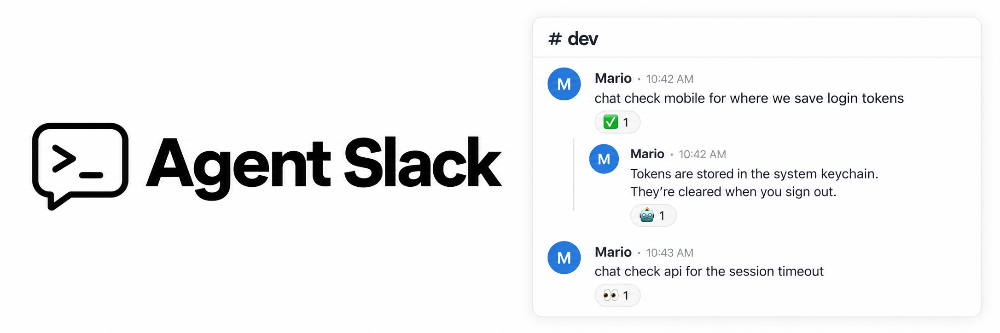

# Agent Slack



Run your local coding tools from Slack. Only your messages trigger work; answers appear in the same thread. Commands and project directories are configured in `.env`.

**Setup** requires Python 3.10+, a [Slack app](docs/slack.md), and authenticated CLIs for the wrappers you use:

```sh
cd tools/slack
python3 -m venv .venv
.venv/bin/pip install -r requirements.txt
umask 077
cp .env.example .env
# Fill in tokens, your Slack user ID, commands, and workspace paths.
./run.sh
```

With the example configuration, **`chat investigate project`** runs Codex in `project`. **`claude review service`** runs Claude in `service`. The first project alias mentioned selects the directory; without one, a new thread uses the default workspace and a follow-up keeps its previous directory.

Every request must start with a configured keyword, ignoring case (`chat`, `Chat`, and `CHAT` all work). Follow-ups in the same thread resume its session with new context. Changing commands or directories starts fresh. Up to eight threads run at once; requests within a thread run in order.

**👀** queued or running · **✅** answered · **🤖** AI reply. Failure removes 👀 and logs the error locally.

**Ctrl-C** stops the bridge and its commands. State stays in `~/.local/state/agent-slack`. Restart after editing `.env`; it must have permissions `600`.

Configuration: [.env.example](.env.example) · Custom commands: [wrappers](wrappers/README.md) · Fast checks: `./tests/run.sh`.
